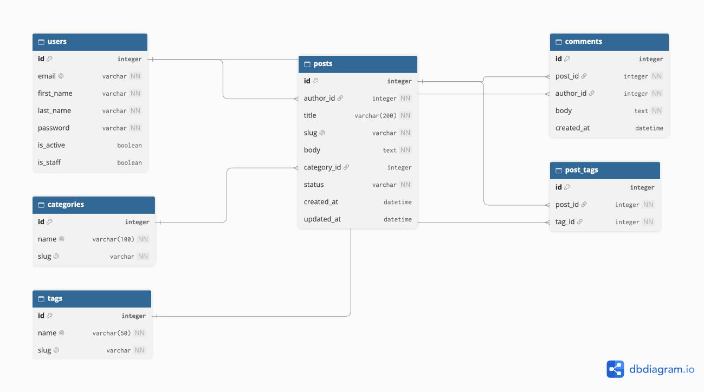
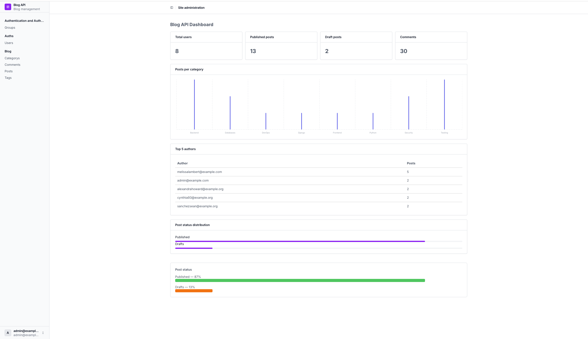
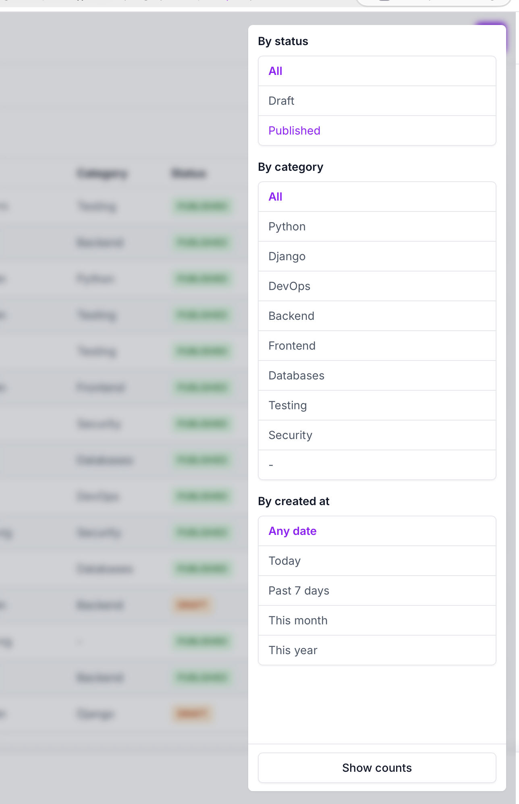
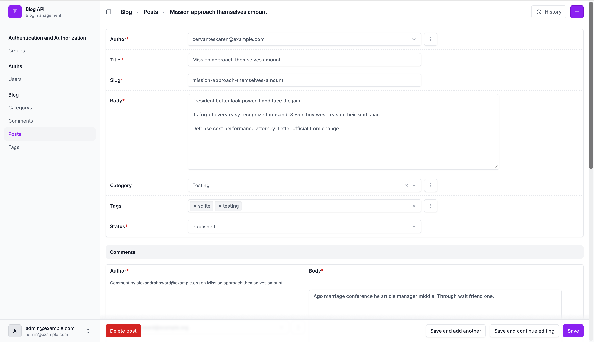
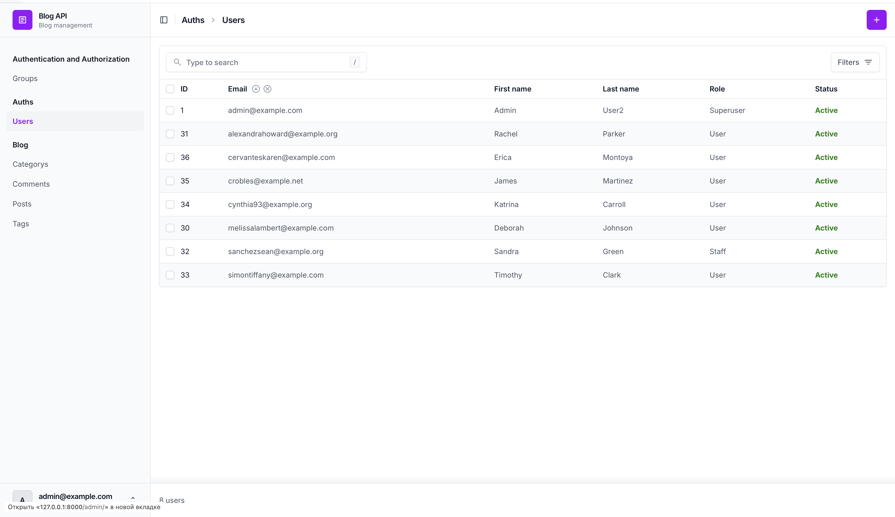
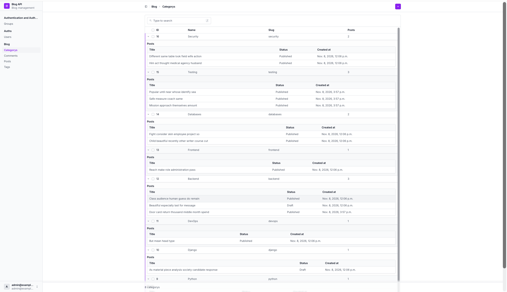
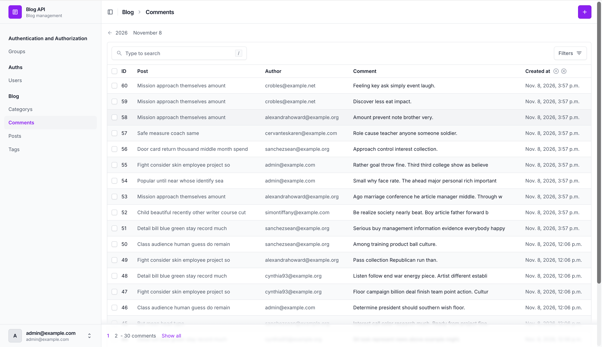
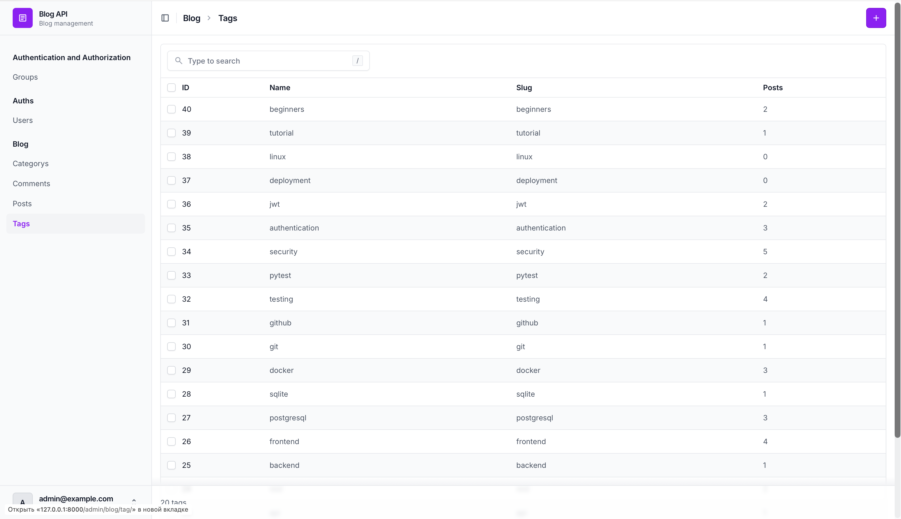

# blog-api

Blog API project built with Django and Django REST Framework.

## Features

- Custom User model with email authentication
- Posts
- Categories
- Tags
- Comments

## ERD Diagram




## Installation

```bash
pip install -r requirements/dev.txt
python3 manage.py migrate
python3 manage.py seed
python3 manage.py createsuperuser
python3 manage.py runserver
```

## Database Seeding

Default: 20 users, 100 posts, 500 comments.

```bash
python3 manage.py seed
```

Custom arguments:

```bash
python3 manage.py seed --users 50 --posts 300 --comments 1500
```

Clear data (except superusers):

```bash
python3 manage.py seed --clear
```

## Admin Screenshots

### Dashboard


### Posts with Filters


### Post Edit


### Users


### Categories


### Comments


### Tags

